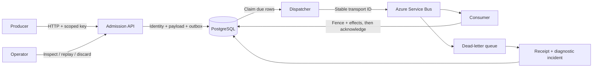
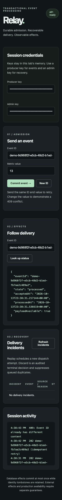

# Relay

**Durable events. Idempotent processing. Auditable recovery.**

Relay is a transactional event-processing service built with C# and .NET 10. It accepts versioned events over HTTP, commits them to PostgreSQL, delivers them through Azure Service Bus, and applies database effects safely across retries and process crashes. A built-in operations console makes delivery failures inspectable and recoverable.

**.NET 10 · ASP.NET Core · PostgreSQL · Azure Service Bus · OpenTelemetry · Prometheus**

## What Relay handles

A request can commit before its HTTP response reaches the producer. A broker publish can succeed before the dispatcher records success. A consumer can commit its effects and crash before acknowledging the message.

Relay treats these as ordinary recovery paths:

- **Transactional admission:** event identity, payload, and outbox entry commit together before HTTP 202.
- **Idempotent effects:** a unique business-identity fence and all handler writes share one PostgreSQL transaction.
- **Concurrent dispatch:** workers claim due outbox rows with `FOR UPDATE SKIP LOCKED` and publish size-aware batches with stable transport IDs.
- **Operator recovery:** dead-letter capture preserves receipts and diagnostics; replay and discard are authorized, transactional, and audited.
- **Versioned contracts:** strict validation, canonical content hashes, and explicit schema evolution make retries predictable.
- **Observable execution:** trace context follows admission, dispatch, and consumption; application metrics and alert rules expose delivery health.

## Architecture



`Relay.Api` serves ingestion, event status, recovery endpoints, and the console. `Relay.Worker` runs configurable dispatcher, consumer, DLQ-capture, and retention roles. `Relay.Migrator` applies versioned EF Core migrations and provisions scoped identities. Parameterized Npgsql repositories own the transactional hot paths.

### Two identities, two responsibilities

The business identity is `(producer_id, event_id)`. Reusing it with the same canonical content is an idempotent retry; different content returns **409 Conflict**. Database effects are fenced by that identity.

The transport identity is `relay:<outbox_id>`. Retrying an outbox row preserves it. An intentional replay creates a new outbox row and transport ID, allowing immediate replay through broker duplicate detection while preserving the original business identity.

**202 means durable admission.** The event-status endpoint reports when processing has committed. Committed Relay database handler effects occur at most once while identity fences are retained. Payload retention and identity retention are separate: resolved payloads can expire while identity, completion, and capture-receipt records remain.

## Run locally

Prerequisites: Docker with Compose, Python 3, and the .NET 10 SDK pinned in `global.json`. The tested Apple Silicon setup uses a dedicated Colima VM with 4 CPUs, 6 GiB RAM, and Rosetta for the SQL Server dependency. Linux amd64 is used by CI.

The configuration script sets `ACCEPT_EULA=Y`. Before running it, accept the [Service Bus emulator](https://github.com/Azure/azure-service-bus-emulator-installer/blob/main/EMULATOR_EULA.txt) and [SQL Server](https://go.microsoft.com/fwlink/?LinkId=746388) license terms.

```sh
python3 scripts/configure-demo.py
python3 scripts/demo.py up
```

Open [the operations console](http://127.0.0.1:5080). Paste the producer and operator keys from the private, ignored `artifacts/local-secrets.json` file. Keys stay in the tab's memory.

1. Send an event and follow its status to `processed`.
2. Submit the same ID and value to see an idempotent 202.
3. Change the value under that ID to see a 409 conflict.
4. Use the [recovery walkthrough](docs/recovery.md) to inspect and replay a captured delivery failure.



Stop the local application and infrastructure with:

```sh
python3 scripts/demo.py down
```

Published ports bind to loopback. PostgreSQL volumes persist across ordinary shutdowns.

## Event contracts and API

Supported events are `metric.reported` v1/v2, `deployment.completed` v1, and `log.batch` v1. Metric v1 upcasts its absent unit to `unspecified`; v2 requires an explicit unit. The authenticated key supplies the producer identity.

```json
{
  "eventId": "build-latency-42",
  "type": "metric.reported",
  "schemaVersion": 2,
  "occurredAt": "2026-09-20T09:00:00Z",
  "data": { "name": "build.latency", "value": 120, "unit": "ms" }
}
```

| Endpoint | Purpose | Required scope |
|---|---|---|
| `POST /v1/events` | Durable event admission | `events.write` |
| `GET /v1/events/{eventId}` | Producer-scoped delivery status | `events.read` |
| `GET /v1/admin/incidents` | Cursor-paginated delivery incidents | `relay.admin` |
| `GET /v1/admin/incidents/{id}` | Capture diagnostics and transport metadata | `relay.admin` |
| `POST /v1/admin/incidents/{id}/replay` | Schedule an audited replay | `relay.admin` |
| `POST /v1/admin/incidents/{id}/discard` | Record an audited terminal decision | `relay.admin` |
| `/health/live`, `/health/ready` | Process and dependency health | Public |

Authentication uses random 256-bit keys stored as SHA-256 hashes. Pre-authentication budgets, producer rate limits, bounded request bodies, strict JSON readers, and backlog-based shedding protect admission. Keys and event payloads are excluded from application logs.

## Reliability verification

The verification suite exercises real PostgreSQL transactions, the Service Bus emulator, HTTP endpoints, child-process crashes, and published Release containers.

| Scenario | Recorded result |
|---|---|
| .NET contract, database, authentication, and broker tests | 40 passed, no skips |
| Python credential and observability regressions | 6 passed |
| Process crashes at transaction and acknowledgement boundaries | 13 checks passed |
| Duplicate traffic with repeated consumer restarts | 200 admissions reconciled to 200 exact effects |
| Two-worker load scenario | 3,000 admissions with exact count/sum/min/max reconciliation |
| Recovery operations | Replay, discard, repeat-action conflicts, and actor audit verified |
| Observability | Fresh causal traces, Azure SDK spans, OTLP metrics, and Prometheus scrape verified |

With the local infrastructure running:

```sh
python3 scripts/verify.py
```

This restores locked dependencies, checks formatting, builds Release and FaultTests artifacts, runs integration and fault scenarios, rebuilds the demo containers, and writes machine-readable reports under `artifacts/`. Fault hooks are compiled only into `FaultTests`; the gate checks their exclusion from Release artifacts. GitHub Actions runs the core reliability suite on pushes and pull requests, with sustained scenarios on scheduled and manual runs.

See the [verification record](docs/verification.md) for execution dates, measured latencies, environment details, and reproduction instructions.

## Project map

```text
src/
  Relay.Contracts/       Versioned envelopes and canonical validation
  Relay.Core/            Domain models and transactional interfaces
  Relay.Infrastructure/  PostgreSQL store, migrations, broker transport
  Relay.Api/             HTTP endpoints, authentication, operations console
  Relay.Worker/          Dispatch, consumption, capture, retention
  Relay.Migrator/        Schema migrations and identity provisioning
tests/Relay.Tests/        Contract, database, authentication, broker tests
scripts/                 Local orchestration and reliability verification
deploy/                  Containers, collector, Prometheus, alert rules
```

Further reading: [guarantees and lifecycle](docs/guarantees.md), [architecture decisions](docs/adr/README.md), [operations runbook](docs/runbook.md), [security model](docs/threat-model.md), and [repository history](docs/history.md).
